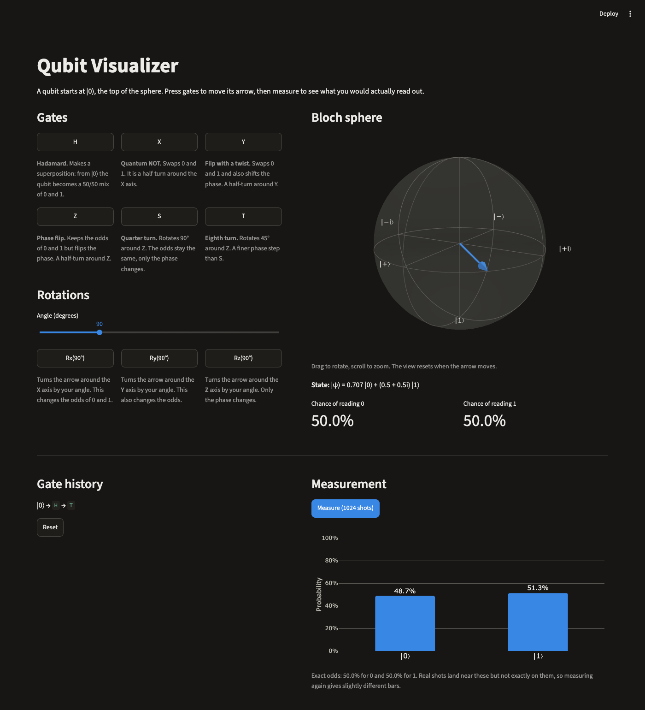

# Qubit Visualizer

An interactive way to learn how quantum gates work. Apply gates to a single qubit, watch its state move on a 3D Bloch sphere, then measure it on the Qiskit simulator.



## Features

- **Gates:** H, X, Y, Z, S and T, plus Rx, Ry and Rz with an angle slider
- **Bloch sphere:** an interactive 3D view you can rotate and zoom
- **Gate history:** the gates applied so far, with a Reset button
- **Measurement:** 1024 shots on the Qiskit Aer simulator, shown as a probability bar chart
- **Explanations:** a short, beginner-friendly description under each gate

## Run it

You need Python and Git. The app was tested on Python 3.14 on macOS.

```bash
git clone https://github.com/jvliebold-jpg/qubit-visualizer.git
cd qubit-visualizer
python3 -m venv .venv
.venv/bin/python -m pip install -r requirements.txt
.venv/bin/streamlit run app.py
```

Streamlit prints a local address, usually http://localhost:8501. Open it in your browser if it doesn't open by itself. Press `Ctrl+C` in the terminal to stop the app.

## Try this

1. Press **H**. The arrow moves to the equator, giving a 50/50 chance of reading 0 or 1.
2. Press **Measure** and check that the two bars are close to 50%.
3. Press **H** again, then **Measure**. The arrow is back at |0⟩, so every shot reads 0.
4. Press **Reset**, then **Z**. The arrow stays put because it already lies on the Z axis.

## How it works

Each press adds a gate to the history, and the app rebuilds a one-qubit Qiskit circuit from that history. The sphere and the probabilities come from the circuit's exact statevector. Measuring runs the same circuit on `AerSimulator`, so the bars show real sampling noise around the exact odds.

Each measurement starts again from the full circuit, so measuring doesn't collapse the qubit in the app. You can keep adding gates afterwards.

## Project files

| File | Purpose |
| --- | --- |
| `app.py` | The Streamlit app |
| `qiskit_preload.py` | Loads Qiskit on a long-lived thread to prevent a crash under Streamlit. Keep its import above the Qiskit imports in `app.py`. |
| `requirements.txt` | Pinned dependencies |
| `.streamlit/config.toml` | Accent colors for the light and dark themes |

## Known limitation

The sphere returns to its default view whenever the arrow moves, because Streamlit rebuilds the chart when its data changes.
